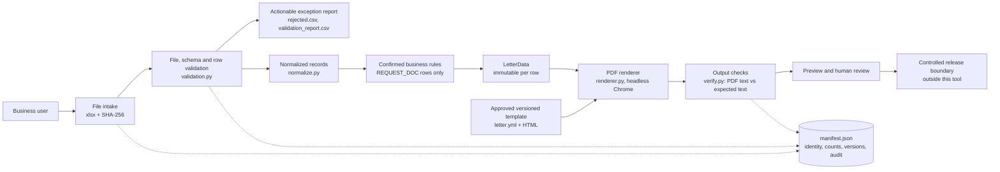
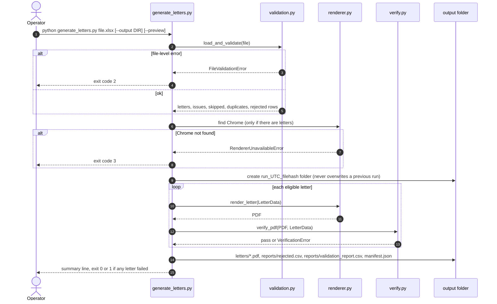
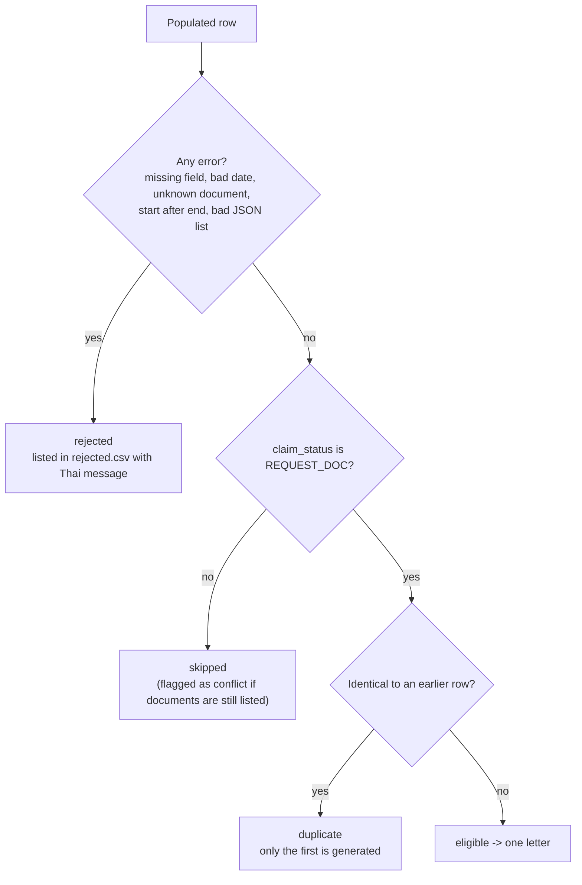
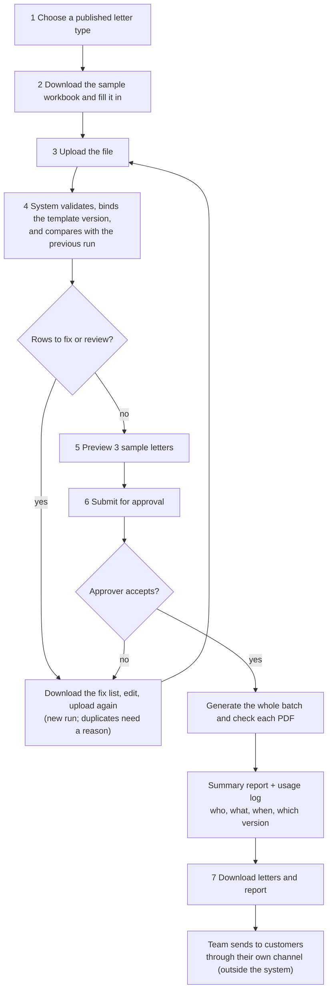

# Auto-gen

**Spreadsheet in, reviewed PDF letters out: a document-automation case study with a working proof of concept (Assignment 2) and a platform design with a user guide (Assignment 3).**

 -217346?style=for-the-badge&logo=microsoftexcel&logoColor=white)    

> **Status: assessment case study.** Assignment 2 has a runnable local CLI (`poc/`). Assignment 3 (a central Document Automation Platform) is a **design proposal only**; the platform does not exist. There is no Assignment 4 material in this repository. The tool **never sends letters to customers**: it produces files for a human to review and release.
>
> **Confidentiality:** the task data in `data/` comes from a confidential brief (`poc/README.md` says it must not be published). See [Security, privacy and limitations](#security-privacy-and-limitations).

Last updated: 2026-11-03.

---

## Thai summary (สรุปภาษาไทย)

โปรเจกต์นี้คือกรณีศึกษาระบบสร้างจดหมายขอเอกสารเพิ่มเติมอัตโนมัติ: อ่านไฟล์ Excel รายการเคลม (`REQUEST_DOC` / `APPROVED` / `REJECTED`) ตรวจข้อมูลทีละแถว สร้างจดหมาย PDF ภาษาไทยเฉพาะแถว `REQUEST_DOC` ด้วย Headless Chrome ตรวจข้อความใน PDF กับข้อความที่ควรเป็น แล้วเขียน manifest และรายงาน ไม่มี LLM ในส่วนที่รัน และไม่ส่งจดหมายถึงลูกค้า (ให้คนตรวจและปล่อยเอง) Assignment 2 มีโค้ดใน `poc/` และ 133 เทสต์ตาม `poc/README.md` ส่วน Assignment 3 (`as3/`) เป็นข้อเสนอแพลตฟอร์มกลางสำหรับหลายทีม พร้อมคู่มือผู้ใช้และ mockup ยังไม่ได้สร้างจริง

---

## Problem

A claims team receives a spreadsheet of claims. Rows whose status is `REQUEST_DOC` need a letter asking the customer for additional documents. Doing this by hand is slow and error-prone: wrong customer-to-letter mapping, broken Thai glyphs, duplicate sends, and half-finished batches. The case study asks for (2.1) a workflow, (2.2) a two-week operating process with users, and (2.3) failure prevention and recovery, then (Assignment 3) how to scale the idea to many teams and document types.

## Design principles

| Principle | In the proof of concept |
|---|---|
| Fail before generating | File-level problems (missing sheet, wrong headers, unreadable file) stop the batch with exit code 2 before any letter is made. |
| Nothing is guessed | Values the rules cannot interpret produce an issue instead of a letter. Every populated row ends in exactly one outcome: rejected, skipped, duplicate or eligible. |
| Deterministic runtime | No LLM, no network calls; the manifest records template version, Chrome version and font hash. |
| Verify the output | Each PDF's extracted text is compared with the expected letter text before it counts as generated. |
| Separate generation from release | A human reviews and releases; delivery is outside the tool. `--preview` adds a banner and a `_preview` folder suffix. |
| Auditable and reconcilable | `manifest.json` records counts and a `reconciled` flag (populated = rejected + skipped + duplicates + eligible, and eligible = generated + failed). |
| Privacy-aware filenames | PDF names use the worksheet row and a hash, not the customer name. |

---

## Repository layout

```
Auto-gen/
├── poc/                         Assignment 2 runnable proof of concept
│   ├── generate_letters.py      CLI: validate -> render -> verify -> reports + manifest
│   ├── validation.py            read workbook as text, file and row validation, classification
│   ├── normalize.py             titles, hospital names, Thai/Buddhist-era dates, document names
│   ├── letter.py + config/      approved wording (letter.yml), document-name table (document_names.yml)
│   ├── renderer.py + templates/ HTML (every value escaped) -> PDF via headless Chrome
│   ├── verify.py                PDF text check (PyMuPDF)
│   ├── models.py                LetterData, RowIssue, SkippedRow, DuplicateRow
│   ├── assets/                  Sarabun font (SIL OFL 1.1), logo
│   ├── scripts/                 demo workbook, logo extraction, PNG rasterizer
│   ├── tests/                   pytest suite
│   └── README.md                Thai run guide
├── as3/                         Assignment 3: platform design
│   ├── ANSWER.md, SPEC.md, ARCHITECTURE.md, PLATFORM_MODEL.md, GOVERNANCE.md, TRADEOFFS.md
│   ├── definitions/, examples/  Document Definition YAML examples + sample workbooks
│   ├── templates/               approved letter template (HTML/DOCX)
│   ├── mockup/, docs/           UI mockups, diagrams, guide images, usability-test plan
│   ├── USER_GUIDE.pdf (+ .src.md)  Thai end-user guide
│   └── tools/, scripts/         build and consistency-check scripts
├── docs/                        A2 changelog, open questions, architecture note, diagrams, examples
├── data/                        task workbook and template PDF (confidential, see below)
├── SPEC.md, ARCHITECTURE.md, FAILURE_MODES.md, DATA_CONTRACT.md, WORKFLOW.md, OPERATIONS.md, FINAL_REPORT.md
```

## Tech stack

<p align="center">
  
</p>

| Layer | Choice (from `poc/requirements*.txt`, `poc/README.md`) |
|---|---|
| Language | Python 3.13 (tested on 3.13.9 only) |
| Excel input | `openpyxl` 3.1.5 (values read as text) |
| Config | `pyyaml` 6.0.3 |
| PDF rendering | Headless Chrome or Chromium (`CHROME_BIN`, `CHROME_NO_SANDBOX=1` for root/containers), bundled Sarabun font |
| PDF text check | `pymupdf` 1.28.2 (AGPL; the only library of those tried that extracted Thai text correctly from Chrome PDFs) |
| Tests / lint | `pytest` 9.1.1, `ruff` 0.16.10 |
| Diagrams | Mermaid (`docs/diagrams`, `as3/diagrams`) rendered with puppeteer config |

---

## System architecture



## Flow 1: One CLI run (sequence)



## Flow 2: Row classification



## Flow 3: Assignment 3 end-user flow (design)

Taken from `as3/diagrams/run_flow.mmd` (the platform is proposed, not built):



The core idea of Assignment 3: separate shared capabilities (intake, validation framework, preview, rendering, output checks, error reporting, audit) from per-document variation (schema, mapping, rules, template, review policy), expressed as versioned **Document Definitions** in YAML (`as3/definitions/`, `as3/examples/definitions/`).

---

## Input data contract

Observed from `data/Example claim table.xlsx` (`Sheet1`, 10 populated data rows; see `DATA_CONTRACT.md`):

| Header | Meaning |
|---|---|
| `customer_name` | Customer name |
| `policy_number` | Policy reference (not a unique request ID) |
| `coverage_start_date` / `coverage_end_date` | Coverage dates (Excel dates; several text formats and Buddhist-era years are handled by `normalize.py`) |
| `hospital_name` | Hospital |
| `claim_status` | Observed: `REQUEST_DOC` (5), `APPROVED` (3), `REJECTED` (2) |
| `document_request` | JSON array of document names; `[]` on non-request rows |

This is a sample, not a verified production contract. Open business questions (eligibility, wording, document vocabulary, retention) are tracked in `docs/OPEN_QUESTIONS.md`.

## Output of one run

```
output/run_<UTC time>_<8-char file hash>/
├── letters/row_0002_<hash>.pdf ...   letters that passed verification
├── reports/rejected.csv              blocked rows with codes and Thai messages
├── reports/validation_report.csv     all issues: errors, warnings, conflicts, duplicates
└── manifest.json                     counts, reasons, versions, reconciliation result
```

Exit codes: `0` success, `1` some letters failed, `2` whole-file problem, `3` Chrome not found.

---

## How to run

From `poc/README.md` and `README` quick start (I did not run these):

```bash
cd poc
python3 -m venv .venv
. .venv/bin/activate
pip install -r requirements.txt

python generate_letters.py "../data/Example claim table.xlsx"
```

Needs Python 3.13 and Chrome or Chromium. Expected result for the sample workbook per `poc/README.md`: **5 letters generated, 5 rows skipped, 0 rejected**.

Messy-input demo:

```bash
python scripts/make_demo_workbook.py            # writes ../docs/examples/messy_example.xlsx
python generate_letters.py ../docs/examples/messy_example.xlsx
```

Linux/containers are **untested** (developed on macOS). Rendering launches Chrome once per letter (about 1 second per letter on the test machine), which has not been tuned for large batches.

## Testing and evaluation

```bash
cd poc
pip install -r requirements-dev.txt
pytest -q        # 133 tests per poc/README.md; PDF tests use real Chrome and are skipped if Chrome is missing
ruff check .
```

Test modules: batch, classification, dates, demo workbook, document names, hospital, renderer, salutation, validation, verify. Limits stated by the authors: extracted PDF text does not show tone-mark positions, so Thai rendering also needs visual inspection (`scripts/rasterize_letters.py`). `FINAL_REPORT.md` records a sample run (10 populated, 5 eligible, 5 skipped, 0 rejected, 5 generated, 0 failed) and a manual visual check. As3 also has consistency and wording checks (`as3/scripts/check_a2_a3.py`, `check_guide_words.py`).

---

## Security, privacy and limitations

| Area | Detail |
|---|---|
| Confidential task data in git | `poc/README.md` states the workbook and template PDF in `data/` are confidential brief material that must not be published, and `data/README.md` says not to commit customer data without redistribution permission. Both files are tracked in this repository. If the repo is public, confirm permission or remove them from the tree and history. |
| Customer PII | Letters contain customer name, policy number, coverage dates and hospital. Output folders (`output/`) are gitignored; keep them access-controlled. |
| No external calls | The runtime has no network or LLM calls. |
| HTML safety | All values are escaped before being rendered to HTML. |
| Filenames | No customer names in PDF filenames. |
| Licence | PyMuPDF is AGPL; legal review is needed before organisational use (`docs/OPEN_QUESTIONS.md`). Sarabun font is SIL OFL 1.1. |
| Business assumptions | Letter wording, company name, contact channels and the document-name table await confirmation from the template owner. |
| Scope | No authentication, queue, durable row states or delivery integration; the production architecture in the docs is a proposal. |
| Assignment 3 | A design only. Items labelled "A2 has this" in `as3/ANSWER.md` are checked against code; everything else is proposed. |

## Credits

Case-study brief and data belong to the assessment sponsor. Fonts: Sarabun and DejaVu (licences in `poc/assets/fonts/` and `as3/assets/fonts/`). Mermaid is vendored for diagram builds in `as3/assets/vendor/`.
