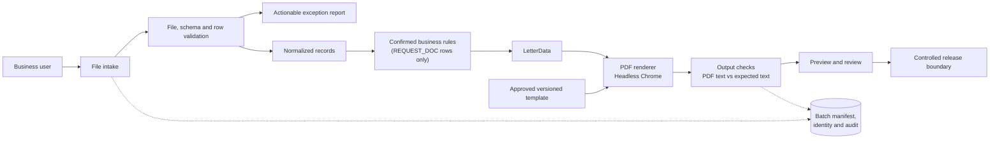

<div align="center">

# Auto-gen

**Spreadsheet in, reviewed PDF letters out: a document-automation workflow with validation and audit.**

 -217346?style=for-the-badge&logo=microsoftexcel&logoColor=white)  

</div>

> The tool does not send letters to customers. It produces files for a human to review and release.

## Tech stack

<p align="center">
  
</p>

## Workflow



## Quick start

```bash
cd poc
python3 -m venv .venv && . .venv/bin/activate
pip install -r requirements.txt
python generate_letters.py "../data/Example claim table.xlsx"
```

Needs Python 3.13 and Chrome or Chromium (used to render HTML to PDF). See [`poc/README.md`](poc/README.md) for the expected output and details, and [`SPEC.md`](SPEC.md), [`ARCHITECTURE.md`](ARCHITECTURE.md), [`FAILURE_MODES.md`](FAILURE_MODES.md) for design notes.

---

